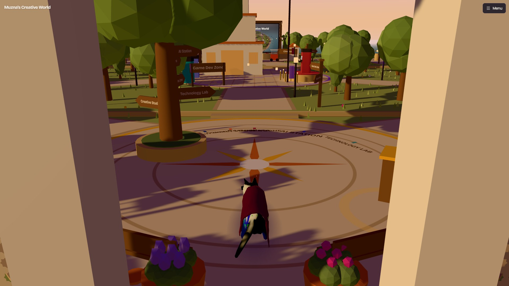
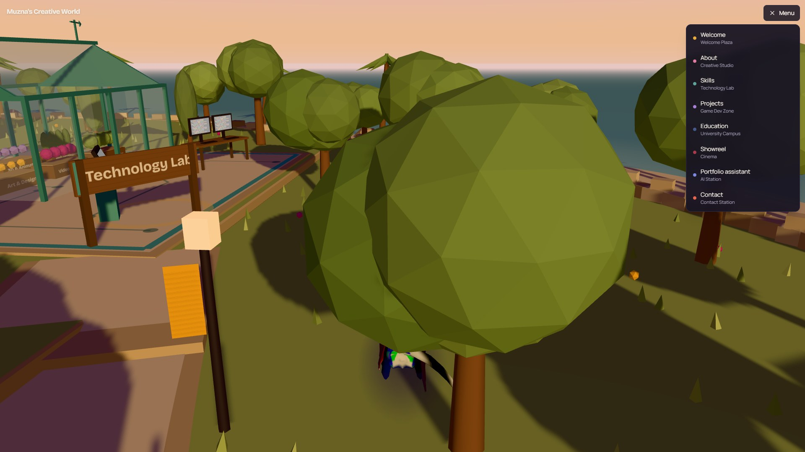
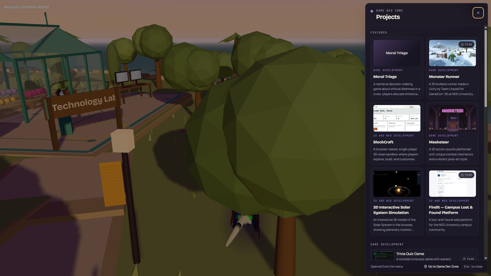
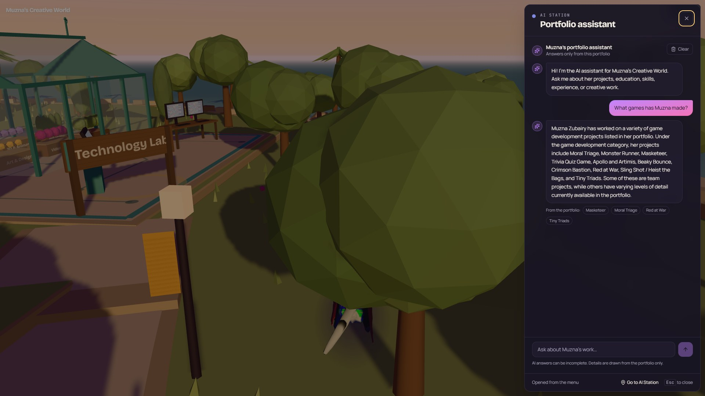
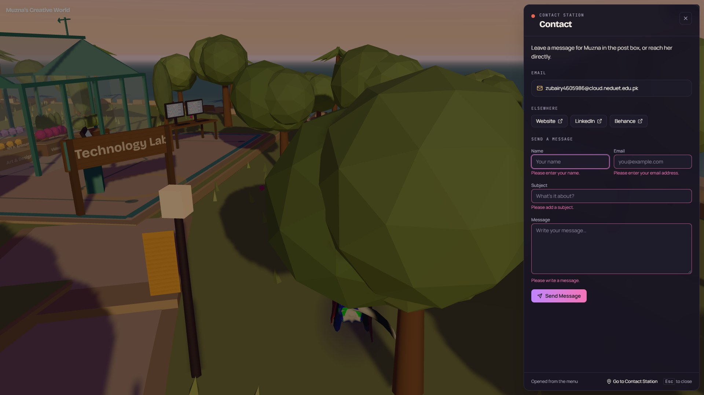

# Muzna's Creative World

An interactive 3D web portfolio by **Muzna Zubairy** (BS Computer Science, Gaming & Animation,
NED University of Engineering and Technology). Visitors explore a small island town as Muzna's
cat avatar; each of the eight locations opens a part of the portfolio. A conventional menu
gives direct access to the same content, so nobody has to explore to read it.

**Live site:** <https://portfolio.muzna.zubairy.world>



## What's inside

| Module | Where it lives |
|---|---|
| 1. 3D web portfolio | Vanilla Three.js world (`src/lib/three/`) with eight locations, plus React panels for Welcome, About, Skills, Projects, Education, Showreel, Portfolio assistant and Contact (`src/components/portfolio/`). Responsive: side drawer on desktop and tablet, bottom sheet on phones, touch joystick on touch screens. |
| 2. Blender avatar | Muzna's cat, modelled, textured and rigged (Rigify) in Blender, exported to GLB (`public/models/Cat Muzna/`). Idle, walk, run and interaction animations drive it in the world. |
| 3. After Effects video | 52-second promotional video (`public/videos/portfolio-intro.mp4`), shown on the Cinema screen, the Showreel panel and the studio easel. |
| 4. RAG chatbot | Portfolio assistant: Gemini embeddings in Supabase pgvector, retrieval, and a grounded Gemini answer with source chips. See [docs/chatbot.md](docs/chatbot.md). |
| 5. Email and contact | Contact Station form, validated in the browser and on the server, emailed through Resend with spam and rate limits. See [docs/contact.md](docs/contact.md). |
| 6. Deployment | Vercel, deployed from the `dev` branch of this repository. |

## Controls

| Action | Keyboard | Touch |
|---|---|---|
| Walk forwards / backwards | W / S or ↑ / ↓ | Push the joystick up / down |
| Turn | A / D or ← / → | Push the joystick left / right |
| Run | Hold Shift | Push the joystick to the top edge |
| Jump | Space | Jump button |
| Interact with the object in reach | E | Tap the "Tap to …" prompt |
| Return to the start | R | |
| Open any section | Menu (top right) | Menu (top right) |

Panels close with ×, Escape, or a click on the dimmed world.

## Tech stack

| Area | Technology |
|---|---|
| Framework | Next.js 16 (App Router, `src/` directory), React 19, JavaScript (.js/.jsx) |
| Styling and UI motion | Tailwind CSS 4, Framer Motion, lucide-react icons |
| 3D | Vanilla Three.js (`GLTFLoader`, `AnimationMixer`), custom lightweight physics |
| Chatbot | Google Gemini (`gemini-embedding-001`, `gemini-3.5-flash-lite`), Supabase PostgreSQL + pgvector |
| Email | Resend REST API |
| Hosting | Vercel |
| Assets | Blender (cat avatar), Adobe After Effects (promotional video) |

Not used: TypeScript, React Three Fiber, Drei, Rapier.

## Setup and installation

Requirements: Node.js 20.9 or newer, a free [Supabase](https://supabase.com) project, a
[Gemini API key](https://aistudio.google.com/apikey) and a [Resend](https://resend.com) account.
The 3D world, panels and video work without any of them; the chatbot and contact form need them.

```bash
git clone https://github.com/MuznaRizwan/portfolio.git
cd portfolio
git checkout dev
npm install
cp .env.example .env.local     # then fill in the values (see below)
```

1. **Database.** In Supabase, open SQL Editor › New query, paste
   `supabase/migrations/001_knowledge_chunks.sql` and run it.
2. **Environment variables** in `.env.local` (all server-only except the Supabase URL):

   | Variable | Used by |
   |---|---|
   | `NEXT_PUBLIC_SUPABASE_URL`, `SUPABASE_SERVICE_ROLE_KEY` | Chatbot (vector search), ingest script |
   | `GEMINI_API_KEY` | Chatbot (embeddings and answers) |
   | `RESEND_API_KEY`, `CONTACT_EMAIL`, `RESEND_FROM_EMAIL` | Contact form |

   `.env.local` is git-ignored. Never commit real keys.
3. **Chatbot knowledge base.** `npm run ingest:preview` writes `knowledge-preview.md` so you can
   read what the assistant will know; `npm run ingest` embeds it and uploads it to Supabase.
4. **Run it.** `npm run dev`, then open <http://localhost:3000>.

| Script | What it does |
|---|---|
| `npm run dev` | Development server (the developer camera panel is shown here, or on a build with `?dev`) |
| `npm run build` / `npm run start` | Production build / serve it |
| `npm run lint` | ESLint (Next.js core-web-vitals rules) |
| `npm run ingest:preview` / `npm run ingest` | Preview / upload the chatbot knowledge base |
| `node scripts/optimize-cat-clips.mjs --write` | Strip the cat's animation GLBs down to their animations (after re-exporting from Blender) |

Imports use the `@/` alias for `src/` (configured in `jsconfig.json`).

## Deployment (Vercel)

1. Import the GitHub repository into Vercel (framework preset Next.js, default build settings).
2. Settings › Environments › Production › Branch Tracking: `dev`.
3. Settings › Environment Variables: add the six variables above for Production and Preview.
4. Settings › Domains: the custom domain `portfolio.muzna.zubairy.world` (also served at
   <https://portfolio-one-mocha-23.vercel.app>). Every push to `dev` then deploys there.

## Project structure

```text
src/
├── app/            Routes, root layout, fonts, global CSS, loading/error/404 pages
│   └── api/        chat (portfolio assistant), contact (Contact Station email via Resend)
├── components/     React only: world/ (canvas mount), overlays/ (title, prompt, touch controls),
│                   navigation/ (menu), portfolio/ (panel and the eight sections)
├── lib/            three/ (engine), physics/, state/, ai/ (Gemini), rag/ (chatbot), chat/,
│                   contact/, server/ (rate limit), supabase/, email/ (Resend)
├── data/           Portfolio content (also the chatbot's source of truth), world layout
├── constants/      Site identity, asset paths, chat and contact limits
├── hooks/          Store subscription, coarse-pointer detection
├── types/          JSDoc type definitions
└── utils/          Small helpers
public/             models/ (cat GLBs), videos/ (promo MP4), images/
supabase/           pgvector migration (chatbot knowledge base)
scripts/            ingest-knowledge.mjs, optimize-cat-clips.mjs
docs/               architecture.md, chatbot.md, contact.md, screenshots/
art-source/         Blender and After Effects working files (git-ignored; in the submission archive)
```

How the engine and React share state, the physics approach and the asset pipeline are
described in [docs/architecture.md](docs/architecture.md).

## Screenshots

| | |
|---|---|
|  |  |
|  |  |

More in [docs/screenshots/](docs/screenshots/): every section at 1920×1080, 1366×768,
768×1024 (tablet) and 390×844 (phone).

## Credits and licences

- Cat avatar, world, code and promotional video: Muzna Zubairy.
- Fonts: Bricolage Grotesque, Manrope and JetBrains Mono (SIL Open Font License, Google Fonts).
- Video music and sound effects: Mixkit, under the Mixkit free licences
  (`art-source/after-effects/audio/LICENSES.txt`).
