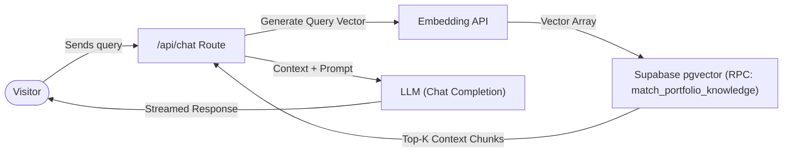

# Architecture Documentation

## Project Title
**Design and Development of an Interactive 3D Web Portfolio**

---

## 1. System Overview

The portfolio is structured as a decoupled, modern Jamstack/serverless web application deployed on Vercel, utilizing:
- **Client Presentation**: Next.js App Router, React 19, Tailwind CSS, Framer Motion.
- **Interactive 3D Canvas**: Three.js, React Three Fiber (R3F), and React Three Drei.
- **Creative External Assets**:
  - Custom 3D Avatar (`public/models/muzna-avatar.glb`) modeled, rigged, and animated in Blender.
  - Promotional Showcase Video (`public/videos/portfolio-intro.mp4`) created in Adobe After Effects (`Portfolio_Intro.aep`).
- **Backend & Serverless Endpoints**: Next.js Route Handlers (`/api/chat`, `/api/contact`, `/api/ingest`).
- **Data & Vector Storage**: Supabase (PostgreSQL with `pgvector` extension for cosine similarity search).
- **AI & RAG Pipeline**: Embedding model for vector representation and LLM generation for conversational QA.
- **Communications**: Resend API for transactional contact email dispatch.

---

## 2. Directory Layout & Separation of Concerns

```text
muzna-portfolio/
│
├── public/                     # Static assets served directly by Next.js
│   ├── models/                 # Blender GLB/glTF exports (e.g. muzna-avatar.glb)
│   ├── videos/                 # After Effects MP4 exports (e.g. portfolio-intro.mp4)
│   ├── images/                 # Raster graphics, profile photos, icons
│   └── textures/               # Three.js HDR environments, matcaps, PBR textures
│
├── src/
│   ├── app/                    # Next.js App Router (pages, layouts, route handlers)
│   │   ├── page.tsx            # Main Landing Page (Hero, 3D Canvas Mount, Highlights)
│   │   ├── about/              # Biography, skills, academic background
│   │   ├── projects/           # Showcase of creative and code deliverables
│   │   ├── contact/            # Contact inquiry form
│   │   └── api/                # Backend API route handlers
│   │       ├── chat/           # RAG retrieval and LLM response endpoint
│   │       ├── contact/        # Resend email handler
│   │       └── ingest/         # Vector embedding ingestion endpoint
│   │
│   ├── components/             # Reusable React components
│   │   ├── layout/             # Header, Footer, Navigation, Container
│   │   ├── sections/           # HeroSection, VideoShowcase, ProjectsGrid
│   │   ├── three/              # Canvas, Scene, Lights, AvatarModel loader
│   │   ├── chatbot/            # Floating Chatbot Drawer, MessageItem, InputBox
│   │   └── ui/                 # Atomic UI (Buttons, Badges, Modals, Cards)
│   │
│   ├── lib/                    # Core library wrappers and backend clients
│   │   ├── supabase/           # Browser and server Supabase clients
│   │   ├── ai/                 # Embeddings and LLM client helpers
│   │   └── email/              # Resend API client
│   │
│   ├── data/                   # Static content, initial knowledge base docs
│   ├── hooks/                  # Custom React hooks (useChat, useThreeAnimation, etc.)
│   └── types/                  # Shared TypeScript interfaces and types
│
├── supabase/
│   └── migrations/             # SQL scripts (pgvector extension, table schemas, RPCs)
│
├── docs/                       # Project documentation, diagrams, academic reports
├── .env.example                # Template for required environment variables
├── .gitignore                  # Git exclusions (credentials, node_modules, .next)
├── README.md                   # Setup guide and project documentation
└── package.json                # Project dependencies and npm scripts
```

---

## 3. RAG Chatbot Architecture



1. **Ingestion**: Portfolio documents (biography, skills, academic achievements, project specs) are converted to high-dimensional embeddings and stored in Supabase with `vector` data types.
2. **Retrieval**: When a visitor enters a prompt in the chatbot, `/api/chat` calls the embedding model to create a query vector, searches Supabase using cosine similarity via `match_portfolio_knowledge`, and pulls the most relevant context.
3. **Generation**: The retrieved context is passed with system instructions to the LLM to generate an accurate, grounded reply about Muzna.
